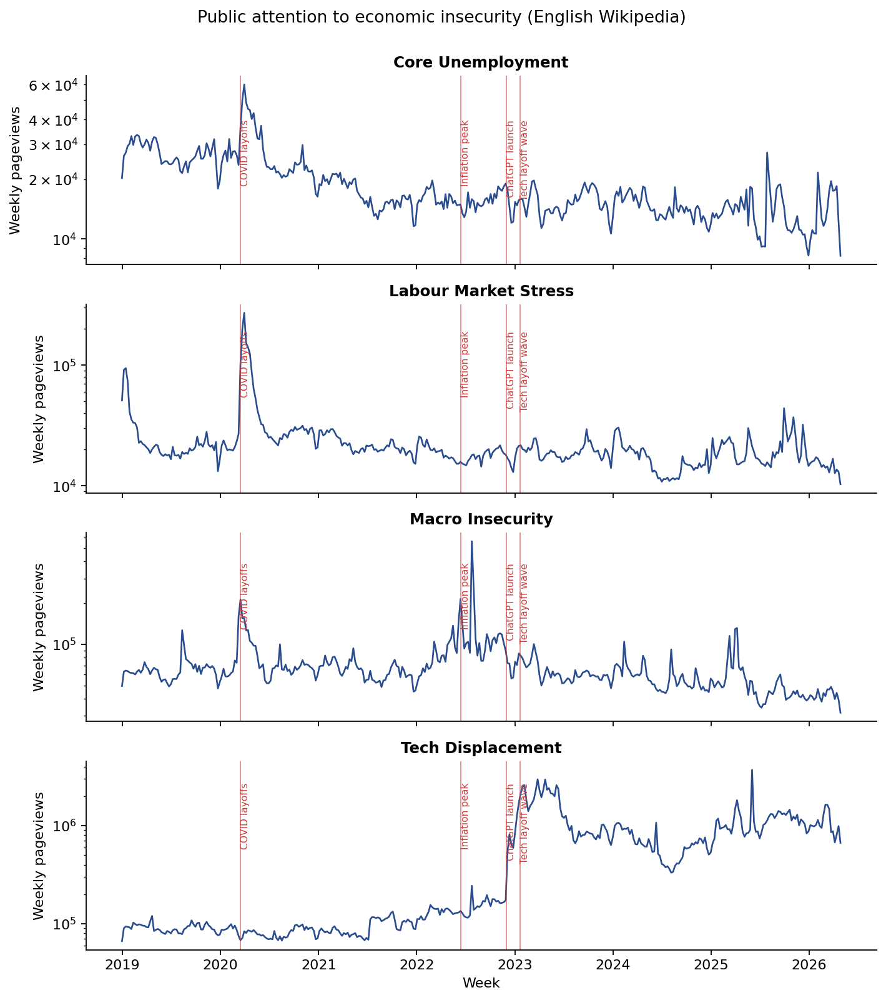
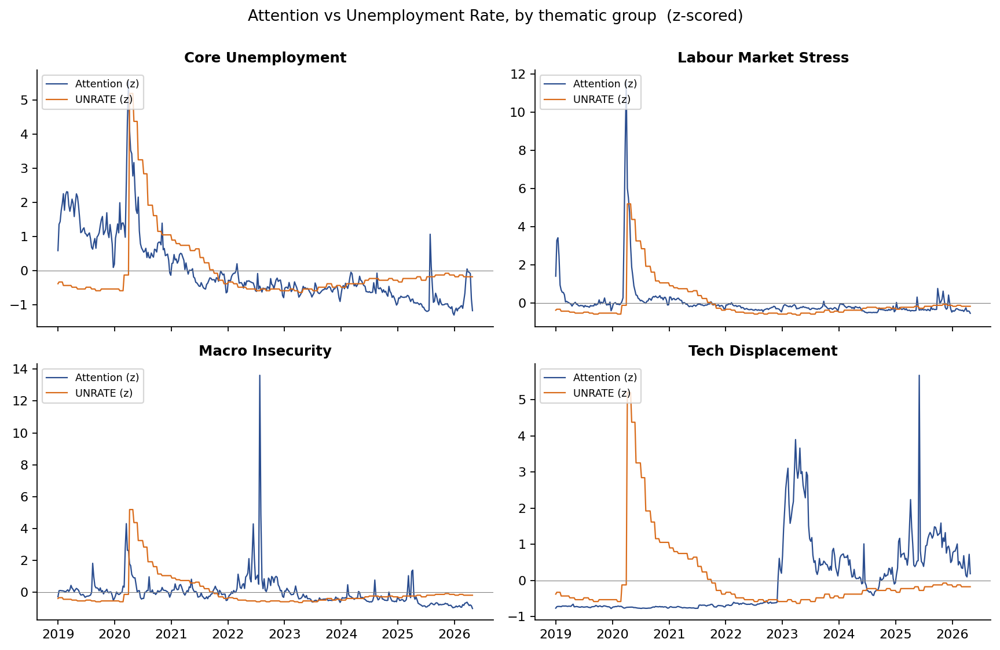
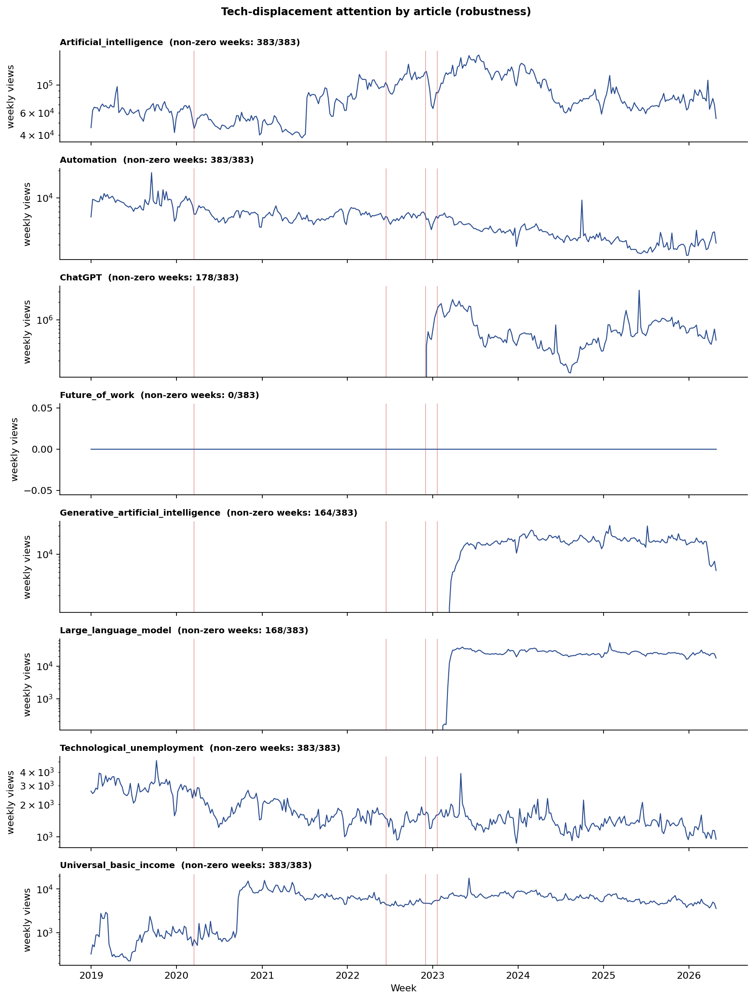

# Public Attention to Unemployment and Economic Insecurity: A Wikipedia-Pageviews Analysis (2019–2026)

**LSC4SS Final Project — Solo project.**
**Author:** Yinyuan Chen
**Course:** Large-Scale Computing for the Social Sciences, Spring 2026
**Platform:** UChicago RCC Midway3 (Slurm, caslake partition)
**Repo:** https://github.com/macs30113-s26/final-project-unemployment-signals

---

## Executive Summary

This project measures public attention to unemployment and economic insecurity via Wikipedia pageviews on 31 curated articles across four thematic groups (`core_unemployment`, `labour_market_stress`, `macro_insecurity`, `tech_displacement`) from January 2019 through May 2026, tested against BLS jobless-claims data from FRED. Of three hypotheses tested, **H1 (classical-unemployment attention Granger-predicts initial jobless claims) is consistent with the data; H2 (tech-displacement attention is decoupled from realised labour-market stats) is consistent; H3 (ChatGPT launch caused a structural break in labour-displacement anxiety) is rejected by a §5.5 robustness check** — the break disappears when articles created after the launch window are excluded, exposing a measurement artifact rather than a structural shift. The compute pipeline is fully Slurm-scheduled: REST and dump ingest each run as `sbatch` jobs (8 total in §8), and aggregation runs as a [Dask SLURMCluster](https://jobqueue.dask.org/) that submits **5 simultaneous Slurm job_ids** per run (1 scheduler + 4 cross-node workers) and operates on a 30,275-node task graph over 2,716 hourly dump files (~130 GB raw streamed); cross-source validation against REST reconciles to **median 1.74%** on 2,927 daily (article, day) pairs.

---

## 1. Research Question

How did public attention to unemployment and economic insecurity change between 2019 and 2026, and how did that attention respond to four macro-economic shocks: the March-2020 pandemic layoff wave, the 2022 inflation surge, the November-2022 ChatGPT launch, and the 2023 tech-sector layoff cycle?

Wikipedia pageviews capture an *anxiety* channel — what people search when they are personally uncertain — that complements survey- and admin-data measures of unemployment (which capture realised behaviour with a publication lag). Three concrete hypotheses are tested:

1. **H1 — Predictive lead.** Wikipedia attention on classical-unemployment articles temporally precedes the BLS initial-jobless-claims series.
2. **H2 — Separation of channels.** AI / automation-themed articles do not show the same temporal precedence relative to jobless claims that classical articles do.
3. **H3 (original) — AI-era structural break.** The 2022-11-30 ChatGPT launch produced a structural break in technological-displacement attention. *This hypothesis is revisited in §5.5 and rejected after a robustness check.*

## 2. Repository Layout

Every file below is a working component of the final pipeline (or archived as failed-attempt documentation). Click any link to jump to the file on GitHub.

```
final-project-unemployment-signals/
│
├── README.md                                              ← this file
├── requirements.txt                                       Python deps
├── .gitignore
│
├── config/
│   └── articles.yaml                                      31 canonical articles + aliases, 4 groups
│
├── ingest/                                                Layer 1: parallel HTTP ingest
│   ├── ingest_pageviews_rest.py                           PRIMARY — REST API, user-only, 6-worker pool
│   ├── ingest_pageviews.py                                VALIDATION — raw dump pull, 4-worker pool, backoff
│   └── verify_articles.py                                 Wikipedia title/redirect smoke check
│
├── aggregate/                                             Layer 2: daily → weekly/monthly rollup
│   ├── aggregate_dask.py                                  Dask aggregator (SLURMCluster or LocalCluster)
│   ├── aggregate_dask_smoke.py                            LocalCluster smoke test (Day 1)
│   ├── aggregate_pandas.py                                pandas fallback (~5 s on 75k rows)
│   ├── validate_dask_dump_vs_rest.py                      daily-grain cross-source validation (Day 2)
│   └── validate_dump_vs_rest.py                           original weekly cross-source check
│
├── analyze/                                               Layer 3: Granger + PELT + figures
│   ├── analyze.py                                         main analysis
│   ├── analyze_robustness.py                              article-level + subset checks (§5.5)
│   └── figures/                                           all committed outputs
│       ├── 01_attention_by_group.png                      group time series
│       ├── 02_attention_vs_unrate.png                     attention vs UNRATE
│       ├── 03_tech_articles_breakdown.png                 per-article tech_displacement
│       ├── granger_results.csv                            §5.3 numbers
│       ├── changepoints.csv                               §5.4 numbers
│       ├── robustness_changepoints.csv                    §5.5 subset breaks
│       ├── tech_article_coverage.csv                      §5.5 coverage diagnostic
│       ├── user_vs_allagents_comparison.csv               §9.1 bot-share evidence
│       ├── dump_rest_validation.csv                       v1 weekly cross-source check (288 pairs)
│       ├── dask_dump_vs_rest_validation.csv               v2 daily cross-source check (2,927 pairs, §9.2)
│       └── dump_complete_days.json                        complete-day filter (110 days ≥20h)
│
├── sbatch/                                                Dask SLURMCluster pipeline (Day 1+2)
│   ├── ingest_probe.sbatch                                Wikimedia rate-limit probe (49895146)
│   ├── ingest_big1.sbatch                                 14-window dump ingest (49899932, 2716 files)
│   ├── aggregate_dask.sbatch                              REST SLURMCluster aggregator (49897577/992, 49925818)
│   └── aggregate_dask_dump.sbatch                         dump SLURMCluster aggregator (49925215, 49925821)
│
├── logs/                                                  stdout/stderr for Day 1+2 Slurm jobs
│
├── slurm/                                                 ARCHIVED v1 sbatch + logs (§7.2, §7.3)
│   ├── ingest_rest.sbatch                                 v1 REST ingest (49826767, final v1 pipeline)
│   ├── ingest.sbatch                                      v1 diagnostic dump-pull (§7.2)
│   └── logs/                                              14 committed stdout/stderr files (7 jobs × out+err) incl. Spark FAILED
│
└── aws/                                                   ARCHIVED FAILED-ATTEMPT (§7.1)
    ├── README.md                                          incident archive
    ├── ingest/, aggregate/, analyze/                      Lambda + EC2 + Athena source code
    └── requirements_analysis.txt
```

GitHub direct links to the four most-cited files: [README.md](README.md) · [config/articles.yaml](config/articles.yaml) · [ingest/ingest_pageviews_rest.py](ingest/ingest_pageviews_rest.py) · [analyze/analyze.py](analyze/analyze.py) · [analyze/analyze_robustness.py](analyze/analyze_robustness.py) · [analyze/figures/](analyze/figures/) · [slurm/logs/](slurm/logs/) · [aws/README.md](aws/README.md).

## 3. Scope and Data Volume (Honest)

The pipeline operates in two ingest tiers and one analysis tier. What was *actually* processed:

| Tier | Source | Records pulled |
|------|--------|----------------|
| Layer 1A — REST API (primary)       | Wikimedia REST `all-access/user` daily aggregates, 31 articles × 7 years | **75,346 day-records** |
| Layer 1B — raw dumps (validation)   | Wikimedia hourly dumps, sampled                                       | 353 hourly files (~10 days) |
| Layer 2 — pandas aggregation        | Daily → weekly → monthly rollup, year-partitioned CSV                 | 75k → 10,954 weekly rows |
| Layer 3 — analysis                  | Granger lag-VAR + PELT changepoint + matplotlib                       | 383-week panel × 4 groups |

The Wikimedia hourly dump corpus is ~65,000 files (~3 TB compressed) for this window; the dump-pull code ([ingest/ingest_pageviews.py](ingest/ingest_pageviews.py)) is structurally capable of pulling all of them, but we **did not** do so — Wikimedia rate-limited us aggressively (§7.2), and the REST API delivers the same per-article daily totals for the curated 31-article list in 70 seconds (job 49826767). The primary analysis is built on the REST data; the dump sample is used only for cross-source validation (§5.5).

We do not claim TB-scale realised processing. The scalable-computing patterns demonstrated (§4) are real, but the dataset is small.

## 4. Architecture

```
   Wikimedia REST       Wikimedia dumps      FRED public CSV
        │                     │                     │
        │ 31 articles         │ 353 hourly files    │
        ▼                     ▼                     │
   Layer 1A PRIMARY      Layer 1B VALIDATION        │
   multiprocessing       multiprocessing            │
   Pool(6), Slurm        Pool(4), Slurm, backoff    │
        │                     │                     │
        ▼                     ▼                     │
   staging_rest/         staging/                   │
   31 jsonl.gz           353 jsonl.gz               │
        │                     │                     │
        ▼                     │                     │
   Layer 2 AGG               │                     │
   aggregate_pandas.py        │                     │
        │                     ▼                     │
        ▼              validate_dump_vs_rest.py     │
   curated/{daily,             │                    │
   weekly,monthly}/            ▼                    │
        │             dump_rest_validation.csv      │
        ▼                                           │
   Layer 3 ANALYZE  ◄──────────────────────────────┘
   analyze.py + analyze_robustness.py
        │
        ▼
   analyze/figures/  (3 PNG + 6 CSV)
```

### 4.1 Scalable-computing patterns demonstrated

**Multiprocessing-based parallel HTTP ingest, two paths.** Both [ingest_pageviews_rest.py](ingest/ingest_pageviews_rest.py) (REST, 6 workers) and [ingest_pageviews.py](ingest/ingest_pageviews.py) (raw dump, 4 workers with exponential backoff) use `multiprocessing.Pool` to fan out independent downloads. The REST path completes in 70 s; the dump path is the leaf-parallel pattern that would scale to the full corpus given an unrate-limited mirror — the bottleneck is upstream (§7.2), not parallelism.

**Atomic-write idempotency.** Each worker writes to a `.tmp` file and renames after gzip flush; cancelled Slurm jobs (49791029, 49791901) left no partial-write poison. Subsequent submissions correctly skip completed files via `path.exists() + stat().st_size > 0`, making restarts cumulative.

**Two-tier strategy under upstream rate-limiting.** When the dump server's per-IP cap made a full pull untenable (~80 h wall-clock at the only concurrency that did not trigger HTTP 429), we shifted the primary path to the REST API and kept the dump-pull as a validation sample. This is itself a scalable-computing decision: when the upstream resource is rate-limited rather than parallelism-limited, vertical workload reorganisation beats throwing more workers at the leaf.

**HPC scheduling under Slurm with full job-id audit trail.** Both ingest and aggregation run as `sbatch` submissions on the caslake partition; all `stdout`/`stderr` are committed under [logs/](logs/) (new Dask pipeline) and [slurm/logs/](slurm/logs/) (archived v1). The Spark aggregation was originally attempted (job 49794175) but **failed** at startup (JAVA_HOME unset on caslake); §7.3 explains the migration to Dask.

**Distributed aggregation via Dask SLURMCluster.** [aggregate/aggregate_dask.py](aggregate/aggregate_dask.py) uses [dask-jobqueue](https://jobqueue.dask.org/) to launch `N` worker Slurm jobs (each its own `sbatch`) while the scheduler runs in a parent `sbatch` process. A single aggregation run produces **5 simultaneous Slurm job_ids** (1 scheduler + 4 workers) on independent compute nodes — visible in `squeue` and in [logs/aggregate_dump_49925821.out](logs/aggregate_dump_49925821.out). Same Python codepath, two cluster modes: `--cluster local` (LocalCluster, single-node debugging) and `--cluster slurm` (cross-node distributed). On the 2,716-file dump corpus the task graph has 30,275 nodes; compute wall-time is 38 s after worker spin-up. This is Python-only — no JVM dependency — and replaces the failed Spark path.

## 5. Findings

All numbers come from the `all-access/user` REST data (excludes spider/bot traffic; see §10.1). Three figures and six CSV tables are committed under [analyze/figures/](analyze/figures/).

### 5.1 Group-level attention time series



Core_unemployment and labour_market_stress show their largest spike at the March-2020 COVID layoff wave and no visible response to the 2022 inflation surge. Macro_insecurity peaks instead at the 2022 inflation period. Tech_displacement shows a ~10× step change after late-2022, the source of which is investigated in §5.5.

### 5.2 Attention vs UNRATE



Z-scored attention overlaid on the BLS unemployment rate. Around the 2020 shock, classical attention and UNRATE move together with attention appearing to lead UNRATE by a few weeks visually; we do not compute a formal lead-lag cross-correlation in this version. For tech_displacement, attention rises in 2023–2025 while UNRATE is falling — consistent with a news-cycle-driven attention pattern decoupled from realised labour-market movements.

### 5.3 Granger predictive lead (not structural causation)

We run lag-VAR Granger tests on first-differenced raw weekly attention vs. first-differenced raw initial-jobless-claims (no log transform applied — see §10.5), scanning lags 1–8 and reporting the best (smallest p) lag per group. The "best lag" reporting is exploratory and not corrected for the multiple-testing implied by lag selection; the p-values below should be read as descriptive evidence of *temporal precedence* under linear forecasting, not as confirmatory tests.

| group                  | best lag (weeks) | p-value     |
|------------------------|------------------|-------------|
| core_unemployment      | 1                | 3.5 × 10⁻¹⁵ |
| labour_market_stress   | 8                | 2.4 × 10⁻⁷⁵ |
| macro_insecurity       | 7                | 2.1 × 10⁻⁴  |
| tech_displacement      | 1                | 0.970       |

Full table: [analyze/figures/granger_results.csv](analyze/figures/granger_results.csv). The three classical groups all predictively precede jobless claims; tech_displacement does not. Consistent with H1 and H2; not a structural-causation claim.

### 5.4 PELT changepoint detection (not Bayesian)

Algorithm: `ruptures.Pelt(model="rbf")`, a frequentist exact-search algorithm with an RBF cost function. No posterior probabilities are computed. Offset convention: `offset_days = shock_date − break_date`; a negative offset means the break is *later* than the named shock. Full table: [analyze/figures/changepoints.csv](analyze/figures/changepoints.csv).

| group                | break date  | nearest shock              | offset (days) |
|----------------------|-------------|----------------------------|---------------|
| tech_displacement    | 2022-12-05  | ChatGPT launch (2022-11-30) | −5            |
| tech_displacement    | 2023-07-03  | Tech layoff wave            | −164          |
| core_unemployment    | 2020-06-08  | COVID layoffs               | −85           |
| labour_market_stress | 2020-06-08  | COVID layoffs               | −85           |
| macro_insecurity     | 2023-03-20  | Tech layoff wave            | −59           |

Honest reading: only the `tech_displacement` 2022-12-05 break is within two weeks of its named shock. The classical-group breaks are detected ~3 months *after* COVID hit — PELT is picking the post-spike plateau, not the spike date itself. Calling these breaks "tightly aligned" with the named shocks would be overstating; they are temporally *associated* but not coincident.

### 5.5 Robustness: the ChatGPT-aligned break is an article-creation artifact

Coverage check ([tech_article_coverage.csv](analyze/figures/tech_article_coverage.csv)): three of the eight `tech_displacement` articles — `ChatGPT`, `Generative_artificial_intelligence`, `Large_language_model` — did not exist on Wikipedia before late 2022, and `Future_of_work` has only one non-zero week in the panel and should be considered missing data (see config note in [config/articles.yaml](config/articles.yaml)). Re-running PELT on three article subsets ([robustness_changepoints.csv](analyze/figures/robustness_changepoints.csv)):

| Subset                                     | Articles | PELT break dates |
|--------------------------------------------|----------|------------------|
| ALL 8 articles                             | 8        | **2022-12-05**, 2023-07-03 |
| EXCLUDE post-window-created                | 5        | 2020-02-24, 2021-06-28, 2022-08-22, 2024-05-13 |
| LABOR-NARROW (Tech_unempl, Autom, UBI)     | 3        | 2020-06-08, 2020-09-21, 2021-05-24, 2024-05-13, 2025-04-28 |

When the three mid-window-created articles are removed, **no ChatGPT-aligned break is detected**. The ChatGPT article alone accounts for **82.9% of tech_displacement attention since 2023-01-01**.



**H3 is therefore rejected**: the −5-day "ChatGPT break" on the all-article series is mostly an artifact of three AI articles entering the panel in late 2022 / early 2023. The robust signal in `tech_displacement` reflects *AI-product attention* (driven by the ChatGPT article itself), not labour-displacement anxiety.

### 5.6 Summary of hypotheses

| Hypothesis | Verdict |
|------------|---------|
| H1 — classical attention predictively leads jobless claims | Consistent with the data (p < 10⁻³, all three classical groups) |
| H2 — tech_displacement attention is decoupled from realised jobless claims | Consistent with the data (p = 0.97) |
| H3 — ChatGPT launch caused a structural break in *labour-displacement anxiety* | **Rejected.** The break disappears once mid-window-created AI articles are removed, and ChatGPT alone contributes 83% of group attention post-2023. |

## 6. Reproducibility

```bash
ssh CNETID@midway3.rcc.uchicago.edu
git clone https://github.com/macs30113-s26/final-project-unemployment-signals.git wiki-attention
cd wiki-attention
module load python/anaconda-2022.05
python -m pip install --user statsmodels ruptures
sbatch slurm/ingest_rest.sbatch                  # ~70 s, REST primary
python aggregate/aggregate_pandas.py \
    --staging /scratch/midway3/$USER/wiki-attention/staging_rest \
    --curated /scratch/midway3/$USER/wiki-attention/curated
# sinteractive node (needed for FRED HTTP access):
sinteractive --account=macs30113 --partition=caslake \
    --ntasks=1 --cpus-per-task=4 --mem=8G --time=00:30:00
module load python/anaconda-2022.05
python analyze/analyze.py            --curated <...> --out-dir analyze/figures
python analyze/analyze_robustness.py --curated <...> --out-dir analyze/figures
```

## 7. Incidents and Engineering Pivots

Three engineering pivots shaped the final pipeline: (a) the original AWS Lambda + S3 + Spark + Athena fan-out **never completed an end-to-end run** and triggered two AWS Academy Learner Lab account deactivations, prompting migration to Midway3; (b) Wikimedia dump-server rate limiting capped the full-corpus pull at ~80 h wall-clock at safe concurrency, motivating the two-tier REST-primary / dump-validation design (§4); (c) the Spark aggregator failed at startup on caslake (no `JAVA_HOME`, no `spark/*` modulefile), and the pipeline migrated through a brief pandas stopgap to the current Dask `SLURMCluster` design. Full incident detail — IAM denials, 429 patterns, Slurm job ids, dead-code retention policy — is in [**Appendix A**](#appendix-a-incidents-and-engineering-pivots-detailed). Headline incidents are referenced from this section by id only.

## 8. Slurm Job IDs

### Final pipeline (the run whose output produces the figures and CSVs in this repo)

| Stage                          | Job ID         | Wall-clock | Status        | Output            |
|--------------------------------|---------------|------------|---------------|-------------------|
| REST ingest (user, v1)         | **49826767**   | 70 s       | **COMPLETED** | `staging_rest/` → 75,346 day-records (REST primary) |
| Wikimedia rate-limit probe     | **49895146**   | 14 min 42 s| **COMPLETED** | 190/192 hourly dump files; calibrated 0.22 files/s sustained throughput |
| Big dump ingest (14 windows)   | **49899932**   | 2 h 57 min | **COMPLETED** | 14/14 windows OK, 2,716 hourly dump files (~130 GB raw streamed) |
| REST Dask SLURMCluster v1      | **49897577**   | 5.77 s     | **COMPLETED** | 4 workers (49897715–18) across 4 nodes; weekly/monthly CSV |
| REST Dask SLURMCluster v2      | **49897992**   | 6.68 s     | **COMPLETED** | 4 workers across 4 different nodes; per-worker snapshot added |
| REST Dask SLURMCluster (daily) | **49925818**   | 5.91 s     | **COMPLETED** | 4 workers; daily output for cross-source validation |
| Dump Dask SLURMCluster v1      | **49925215**   | 38.49 s    | **COMPLETED** | 2,716-file aggregation; 30,275-node task graph; weekly/monthly |
| Dump Dask SLURMCluster (daily) | **49925821**   | 38 s       | **COMPLETED** | 4 workers (49925822–25), 5-job same-frame in `squeue`; daily output |

All `stdout`/`stderr` for the Dask-pipeline jobs are committed under [logs/](logs/) (file names encode the job_id); the original v1 REST ingest log is at [slurm/logs/rest_49826767.out](slurm/logs/rest_49826767.out). The architecture pivot from a single-`sbatch`/pandas pipeline (v1, May 19) to a Dask-`SLURMCluster`/multi-job pipeline (v2, May 20–) is documented in §7.3 and §4.

### Diagnostic / failed runs (architecture-evolution evidence)

These are not part of the final pipeline; they document the engineering pivots in §7.

| Stage                       | Job ID   | Wall-clock | Status                       | Notes |
|-----------------------------|----------|------------|------------------------------|-------|
| Dump ingest (28-worker)     | 49788236 | 4.5 min    | COMPLETED, 99% HTTP-failed   | First dump attempt — §7.2 |
| Dump ingest (8-worker)      | 49791029 | ~13 min    | CANCELLED                    | 429s persisted at lower concurrency — §7.2 |
| Dump ingest (4-worker)      | 49791901 | ~7 min     | CANCELLED                    | Throughput plateau at 13/min — §7.2 |
| REST ingest (all-agents)    | 49793806 | 69 s       | COMPLETED                    | Superseded by 49826767 (agent filter change) |
| REST ingest (all-agents v2) | 49793986 | ~10 s      | COMPLETED                    | Superseded by 49826767 |
| Spark aggregate             | 49794175 | 56 s       | **FAILED**                   | JAVA_HOME unset — §7.3 |

All stdout/stderr from these jobs are committed under [slurm/logs/](slurm/logs/).

## 9. Known Limitations

**9.1 REST `user` filter.** The final dataset uses `all-access/user`, which excludes Wikimedia's heuristic bot/spider classification. The earlier `all-agents` run inflated total counts by 19.5% on a weighted-mean basis, with per-group bot share ranging 16.2%–26.6% (core_unemployment had the highest bot contamination). Evidence: [analyze/figures/user_vs_allagents_comparison.csv](analyze/figures/user_vs_allagents_comparison.csv), computed from the `staging_rest_allagents/` backup vs. the final `staging_rest/`. The user/agent classifier is itself heuristic.

**9.2 REST vs dump access-type comparison.** Two validation runs exist:

- *v1 (weekly, 288 pairs).* [dump_rest_validation.csv](analyze/figures/dump_rest_validation.csv) covers 288 (article, date) pairs across 11 days from the v1 dump corpus. Median relative difference 11.8%, mean ~102% with a long right tail (most spread came from days with only 1–2 hours of dump coverage — a sampling artifact, not a source-disagreement).

- *v2 (daily, 2,927 pairs).* [dask_dump_vs_rest_validation.csv](analyze/figures/dask_dump_vs_rest_validation.csv) uses the 2,716-file dump corpus (job 49899932) compared against REST at the **daily** grain, restricted to 110 days with ≥20 hours of dump coverage (see [dump_complete_days.json](analyze/figures/dump_complete_days.json)). **Median |rel_diff| 1.74%**, mean 10.46%, p95 85.75%. Signed mean (REST − dump) / dump = **−7.31%**: REST is on average slightly *below* the all-access dump, consistent with REST's `user`-agent filter removing some bot/spider traffic that the dump retains. 40.8% of pairs have REST > dump; 59.2% have dump > REST.

The v2 result is the stronger consistency check: two independent ingest pipelines (REST API and raw hourly dumps) and two independent aggregation pipelines (REST in REST Dask, dump in dump Dask) reconcile to within a few percent on the median article-day. Differences above that level are concentrated in low-traffic article-days where Poisson noise dominates and in days near the bot-share boundary.

**9.3 No alias merging in the REST primary path.** [ingest/ingest_pageviews_rest.py](ingest/ingest_pageviews_rest.py) fetches each canonical title's REST aggregates but does **not** merge aliases listed in [config/articles.yaml](config/articles.yaml). The aliases ARE consumed by the dump-pull code, but since the final analysis is built on REST data, no alias merging is in effect. The config-file header comment was updated to reflect this. If an article was renamed mid-window, the post-rename canonical may under-count compared to the redirect-resolved truth.

**9.4 Construct validity of `tech_displacement`.** §5.5 shows that the group is dominated by AI-product attention (ChatGPT alone is 83% post-2023) rather than labour-displacement anxiety. A cleaner future operationalisation would require either a narrower article list (e.g., `Technological_unemployment` only) or a sentiment-weighted measure.

**9.5 Granger predictability ≠ causation.** §5.3 is a forecast-improvement test on first-differenced series. We select the best-of-8 lags per group and do not correct for multiple comparisons; treat the p-values as descriptive evidence of temporal precedence, not as confirmatory tests of causal structure. The 2020 COVID shock plausibly drives both Wikipedia attention *and* jobless claims, so a common-shock confound cannot be ruled out without an instrument. Additionally, the code applies `.diff()` to raw counts rather than to log-counts. Because pageview series are right-skewed and span several orders of magnitude (COVID spikes are ~10× baseline), the COVID 2020 segment dominates the first-difference variance and may inflate the apparent significance. A log-transformed first difference would be the more defensible specification and is left for future work.

**9.6 No formal lead-lag analysis in figures.** §5.2 reports a *visual* lead of attention over UNRATE in the COVID period; we did not compute a formal cross-correlation or event-study window. A future version should.

**9.7 Scratch storage.** Staging and curated data live on `/scratch/midway3/$USER`, purged after 60 days of inactivity. Outputs and CSVs are committed; raw staging is regenerable from public endpoints.

## References

- Choi, H., & Varian, H. (2012). Predicting the present with Google Trends. *Economic Record*, 88, 2–9.
- Killick, R., Fearnhead, P., & Eckley, I. A. (2012). Optimal detection of changepoints with a linear computational cost. *Journal of the American Statistical Association*, 107(500), 1590–1598. (PELT)
- Wikimedia Foundation. *Pageviews data dictionary*. https://wikitech.wikimedia.org/wiki/Analytics/Data_Lake/Traffic/Pageviews


## Appendix A. Incidents and Engineering Pivots (detailed)

### A.1 Failed AWS Lambda pipeline

The original cloud-fan-out architecture (AWS Lambda + S3 + Spark + Athena) is archived under [aws/](aws/) and **never completed an end-to-end run**. Two attempts triggered AWS Academy Learner Lab account deactivations:

- Concurrency = 40: deactivated at ~12 minutes, $20.30 / $50 spent. Post-deactivation IAM included an `s3:ListBucket` explicit deny that prevented standard resume logic.
- Concurrency = 8 (guardrail at 10): deactivated at ~29 minutes, $0 spent, 2,000 / 21,000 target hours pulled. The lab's per-account Lambda concurrency cap is 10; async retries appear to have transiently exceeded it.

The migration to Midway3 was the direct response. See [aws/README.md](aws/README.md) for the incident archive.

### A.2 Wikimedia dumps rate limiting

Three dump-tier jobs (49788236 at 28 workers; 49791029 at 8; 49791901 at 4) all hit HTTP 429 or plateaued at ~13 files/min. The full 7-year pull would have required ~80 hours and 20+ sequential Slurm submissions. The two-tier design (§4.1) was the response.

### A.3 PySpark failed; migrated to Dask SLURMCluster

Job 49794175 (Spark aggregation) failed at startup: caslake nodes do not export `JAVA_HOME` and no `spark/*` modulefile is available. Rather than building Spark from source, the aggregator was first replaced with [pandas](aggregate/aggregate_pandas.py) as a stopgap (~5 s on 75k rows; sufficient for the REST corpus but not for the larger dump corpus pulled in §4). The pipeline then migrated to [Dask + dask-jobqueue](aggregate/aggregate_dask.py), which preserves the distributed-compute design intent without a JVM dependency: the scheduler runs in one `sbatch` process and submits `N` worker Slurm jobs via `SLURMCluster.scale(jobs=N)`. On the 2,716-file dump corpus this produces a 30,275-node task graph across 4 cross-node workers; same Python codepath works as `LocalCluster` for single-node debugging. The dead Spark code has been removed; only `slurm/logs/aggregate_49794175.{out,err}` is retained as the incident record.
